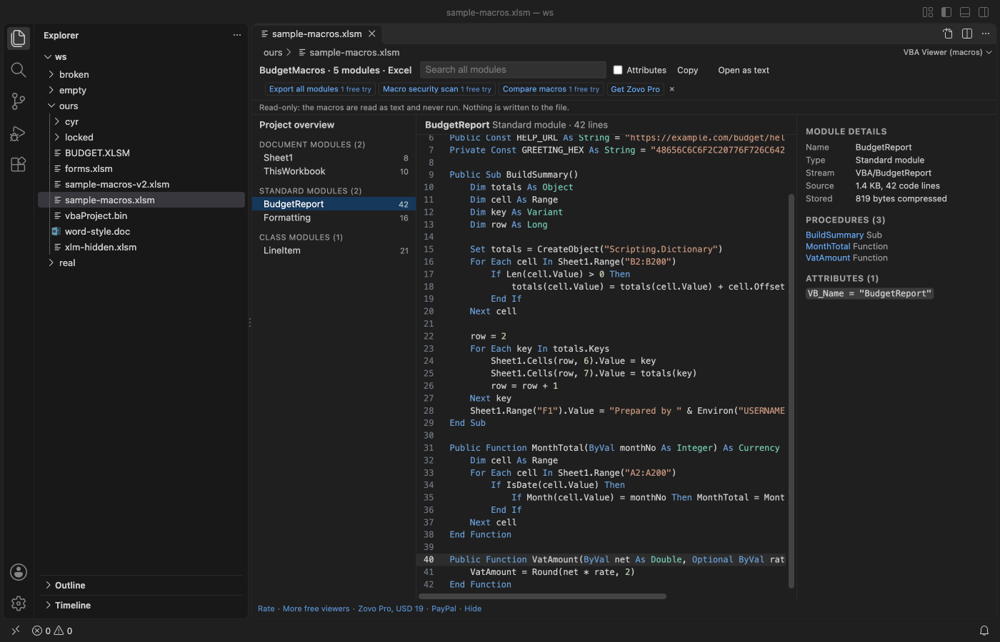

# VBA Viewer & Macro Extractor

Read the VBA macros inside Excel, Word and PowerPoint files in a VS Code tab, without Office and without running them. Made by Zovo.

Free, with no account and no network calls:

- Opens the macros of .xlsm, .xlsb, .xls, .xltm, .xlam, .docm, .dotm, .doc, .pptm, .ppt and vbaProject.bin files.
- A module list grouped as in the VBA editor: document modules (ThisWorkbook, Sheet1, ThisDocument), standard modules, class modules and forms.
- The source of each module with line numbers and VBA syntax colors. The hidden `Attribute` lines are left out, as in the VBA editor; a tick box shows them.
- Search across all modules at once, with a click to jump to the line.
- Module details: type, stream, source and stored size, procedures (click to jump) and attributes. A Copy button, and Open as text for a read-only editor tab.
- A project overview: references, code page, platform and whether the project has a VBA password (the code is still shown; a VBA password only hides it in Office).
- Lists the Excel 4.0 macro sheets of a workbook with their visibility (visible, hidden, very hidden) and, in .xlsm, .xltm and .xlam files, their formulas.
- Read-only and safe: no macro ever runs, nothing is written to the file, and the viewer makes no network calls. A file without macros says so; a damaged file gets a plain message.

Zovo Pro: USD 19 once, for the Pro tools in every Zovo extension. Each Pro tool has 1 free try on your computer first:

- Export all modules: every module to a folder as .bas, .cls and .frm files for git, in one click. A re-export only rewrites the files whose content changed, and lists modules that are gone.
- Macro security scan: auto-run entry points (Workbook_Open, AutoOpen, Document_Open and more), Shell, CreateObject, PowerShell, downloads, Windows API calls, hex and Base64 strings, URLs, IP addresses and file names, and Excel 4.0 macro sheets, in a severity table. Save it as a Markdown or JSON report.
- Compare macros: the macros of two files module by module (changed, only in one file, the same) with lines added and removed, and a side-by-side diff of each module.

## How to use it

- Right-click an Office file in the Explorer and choose Open VBA Macros. The same button is in the editor title bar when the file is open in another editor. Your spreadsheet, document and slide viewers stay the default for these files.
- A file named vbaProject.bin (the VBA part inside an .xlsm package) opens in the viewer directly.
- Reopen with the Default Editor in the editor title goes back to your usual editor for that file.
- Press `/` to jump to the search box. Click a line number to mark a line; Open as text opens the module at that line.
- To try it without a file of your own, run VBA Viewer: Open the Sample Workbook from the Command Palette. The sample's names and amounts are made up, and its code is harmless.
- The Pro tools are in the Command Palette (VBA Viewer: ... (Pro)), in the Explorer right-click menu as Zovo Pro: ..., in the editor title menu of the viewer, and in the small row at the end of the viewer toolbar. The row closes with its x for the rest of the session, and the setting `vbaViewer.showProTools` hides it for good.

## What it reads

| File | Where the macros are |
|---|---|
| .xlsm, .xlsb, .xltm, .xlam, .docm, .dotm, .pptm | The vbaProject.bin part of the ZIP package |
| .xls | The _VBA_PROJECT_CUR storage of the compound file |
| .doc | The Macros storage of the compound file |
| .ppt | The VBA storage embedded in the PowerPoint Document stream |
| vbaProject.bin | The file itself |

The module source is decompressed as the published Microsoft format specification for VBA projects describes, and decoded with the project's code page (for example 1252, 1251 or 932).

Known limits:

- Forms: the code and the form properties are shown and exported, but not the controls on the form, and Export writes no .frx file.
- Only the source code is read, not the compiled code that Office also stores. When the two differ, which some tampered files do on purpose, you see the source.
- Excel 4.0 formulas are listed for .xlsm, .xltm and .xlam files. In .xls and .xlsb files the macro sheets are listed by name and visibility only.
- Files encrypted with a password to open cannot be read.

## Settings

- `vbaViewer.showAttributes`: show the hidden Attribute lines in the source view.
- `vbaViewer.exportEncoding`: `utf8` (default, for git) or `codepage` (the project's own single-byte Windows code page, as the VBA editor writes .bas files).
- `vbaViewer.maxFileSizeMB`, `vbaViewer.showProTools`, `vbaViewer.askForRating`, `vbaViewer.showSupportLinks`.

## Privacy

Nothing leaves your computer. The viewer has no network access (its content security policy blocks every remote load), there is no telemetry, and the file is only read.

## Made by Zovo

VBA Viewer & Macro Extractor is made by Zovo. The file readers (compound file, ZIP, VBA project and decompression) are written for this extension; no third-party code is included. See THIRD-PARTY-NOTICES.md.
